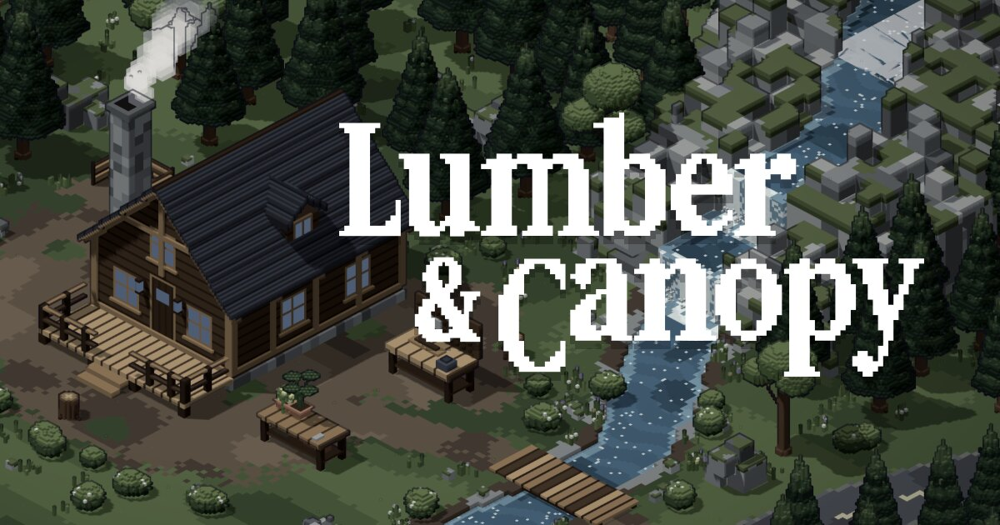

<p align="center">
  
</p>

# Lumber & Canopy

A cozy, eco-friendly voxel game that runs in the browser. Arrive by taxi in a misty forest valley, build a cabin from reclaimed materials, fill it with houseplants you grow and propagate yourself, and befriend a river otter, all without cutting a single tree.

## The game

- **Build a cabin** stage by stage from driftwood and scrap fished out of the river and loose stones the river leaves behind.
- **Fish for debris, never fish:** a timing minigame on the bridge brings up wood, metal, rope, glass and, rarely, bottles with seeds or cuttings.
- **Grow houseplants:** pot seeds and cuttings at the potting table, watch them grow through three stages, then propagate them for more cuttings.
- **Fill your home:** place plants in the garden, on the porch, and in the cutaway two-floor interior: living room, kitchen and bedroom loft.
- **Sell or trade plants** at the delivery box to upgrade your hammer, fishing rod and pickaxe.
- **Make a friend:** feed seeds to a shy otter until it trusts you. It follows you and dives for rare finds.
- **Day and night:** misty mornings, mist that rests on the treetops, boxy clouds over the river and hills, and a warm bed to sleep in until sunrise.

### Controls

| Input | Action |
| --- | --- |
| Click / tap | Walk there |
| Click a marker | Walk to it and use it |
| Drag, or Q / E | Rotate the view |
| Scroll, pinch, or + / − | Zoom |
| W A S D, arrows, right-drag | Pan |
| 1 / 2 / 3 | Hammer, fishing rod, pickaxe |
| I / P | Inventory / plants |
| Space | Reel in while fishing |
| H | Hide the UI for screenshots |
| Esc | Close a panel or stop fishing |

## Tech

- [Next.js 15](https://nextjs.org/) (App Router) with React 19 and TypeScript
- [three.js](https://threejs.org/) for rendering: greedy-meshed voxel models, toon shading, ink outlines, a colour grade and radial mist
- [Zustand](https://github.com/pmndrs/zustand) for game state
- [Supabase](https://supabase.com/) for accounts and saves (optional; see below)

## Getting started

You need Node.js 20 or newer and [pnpm](https://pnpm.io/).

```bash
pnpm install
pnpm dev
```

Open <http://localhost:3000>. Without any configuration the game runs in **offline mode**: accounts and saves are kept in your browser only.

| Script | What it does |
| --- | --- |
| `pnpm dev` | Start the development server |
| `pnpm build` | Production build (stop `pnpm dev` first: they share the `.next` folder) |
| `pnpm start` | Serve the production build |
| `pnpm lint` | ESLint |
| `pnpm typecheck` | TypeScript check |

## Configuration

Copy `.env.example` to `.env.local` and fill in what you need:

| Variable | Purpose |
| --- | --- |
| `NEXT_PUBLIC_SUPABASE_URL` | Supabase project URL. Leave empty for offline mode. |
| `NEXT_PUBLIC_SUPABASE_ANON_KEY` | Supabase **publishable** (anon) key. Never use the secret or service-role key here: `NEXT_PUBLIC_` values are sent to the browser. |
| `NEXT_PUBLIC_SITE_URL` | A custom domain, used for share cards, canonical links and the sitemap. On Vercel, the production address is used automatically when this is empty. |

Deploying: see [docs/DEPLOYMENT.md](docs/DEPLOYMENT.md). Once the repo is connected to Vercel, every push to `main` goes live.

### Setting up Supabase

1. Create a Supabase project.
2. Run [`supabase/schema.sql`](supabase/schema.sql) in the SQL editor. It creates the `profiles` and `progress` tables with row-level security (players can only read and write their own rows), a sign-up trigger, and the `delete_my_account()` function.
3. Under **Authentication → Sign In / Providers**, make sure **Email** is enabled. Keeping **Confirm email** on is recommended.
4. Under **Authentication → URL Configuration**, set the **Site URL** and add `<your site>/reset-password` to the redirect URLs.
5. Put the project URL and publishable key in `.env.local` and restart `pnpm dev`.

## Project structure

```
app/                 Next.js routes: the game, /privacy, /reset-password, SEO files, icons
src/config/          World layout, road, stations, cabin stages, interior, site text
src/engine/          Renderer, isometric camera, day/night, post-processing passes
src/world/           Terrain, water, props, mist and clouds, navigation, character, otter, cabin, interior
src/voxel/           Voxel grid, greedy mesher, palette and every voxel model
src/game/            Game state (Zustand), rules, items, plants, tools, loot, saves, sessions
src/services/        Account and save services (Supabase, or browser-only)
src/ui/              HUD, panels, onboarding screens, pixel-art icons
supabase/            Database schema and security policies
context/             Design references, brand assets and the feature brief
```

## Documentation

The [`docs/`](docs/) folder has the context for working on the game:

- [Gameplay](docs/GAMEPLAY.md): every system and the numbers behind it.
- [Decisions](docs/DECISIONS.md): why things are the way they are.
- [Architecture](docs/ARCHITECTURE.md): how the code fits together, and how to add things.
- [Art direction](docs/ART-DIRECTION.md): the look of the world and the UI.

The original feature brief is [`context/features/pbi-game-enhancements.md`](context/features/pbi-game-enhancements.md). What changed and when is in the [changelog](CHANGELOG.md).

## Privacy

The game only uses a player's email to save their game: no newsletters, no sharing. See the in-game [Privacy page](app/privacy/page.tsx). Before launch, fill in the placeholders on that page and have it reviewed for GDPR / UK GDPR.

## License

No license has been chosen yet, so all rights are reserved by the author.
